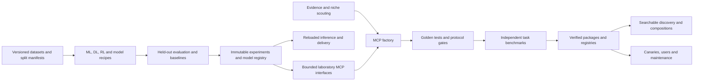

# Laboratory and factory architecture

The existing JavaScript factory remains the production line for independently
installable MCP packages. A separate Python package in `lab/` holds reproducible
training and data tools. This preserves the small runtime dependencies of MCP
servers while allowing serious scientific computing in the laboratory.

Each dataset records a content hash, source, licence, purpose, schema, quality
profile, and split membership. A source or model being publicly downloadable
does not itself grant training rights. Generated smoke datasets are clearly
identified as fixtures and do not count as a production corpus.

Every experiment has a unique identifier and records configuration, seed,
dependencies, code hash, dataset/split hash or environment version, trial state,
metrics, baseline, artifacts and their hashes. A failed run remains in the ledger.
Runs and datasets use a configurable local workspace; private material and
checkpoints stay out of the repository. Small public validation receipts may be
committed after content inspection.

CPU recipes provide a fast functional path. Accelerator and distributed recipes
must separately document supported hardware, memory, deterministic limitations,
checkpoint/recovery, throughput, and resource budgets. The CPU prototype does
not imply a GPU cluster exists.

Model selection uses validation data. Final test data stays independent. RL
evaluation uses new environment seeds and bounded episodes; termination and
truncation are treated according to the environment API. Reports include a
baseline and eventually multiple training seeds with uncertainty.

MCP release gates combine technical conformance with task success. Published
versions must be tied to the exact tested source and fixed benchmark corpus.
Scaffold creation, protocol tests, benchmarks, publication and maintenance each
have their own count and status. Discovery returns a short ranked list with
pagination rather than sending every tool definition to an agent.

Operational growth requires change-impact CI, concurrency limits, health checks,
upstream failure triage, versioned release receipts, ownership and maintenance
capacity. Any cloud expenditure follows a concrete resource plan.
